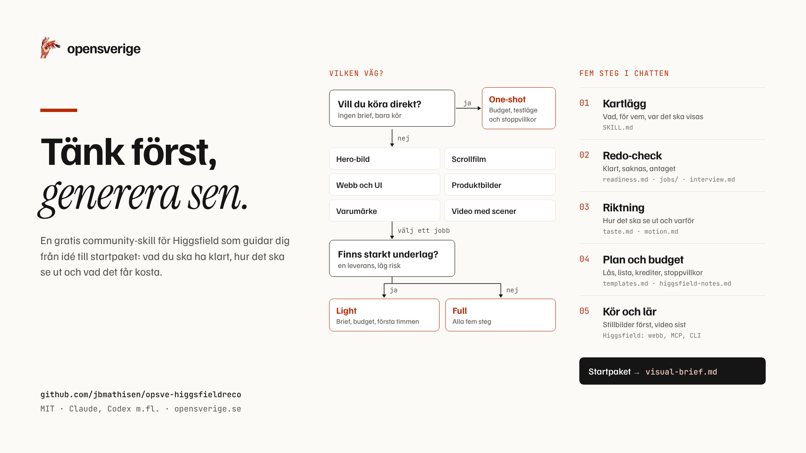

# opsve-higgsfieldreco



> **Status: publik testversion (v0.4).** Vi vill gärna att du provar den på ett riktigt projekt och berättar hur det gick. Se [Testa åt oss](#testa-åt-oss).

En skill som guidar dig innan du bränner krediter på Higgsfield (och Veo, Kling, Seedance, Nano Banana, GPT Image). Den fungerar som en chatt i fem steg: vad gör du, vad är redo, hur ska det se ut och varför, plan och budget, kör och lär. Den läser ditt material, frågar bara om det som saknas (max tre frågor åt gången, alltid med förslag), och ger dig ett startpaket. Vill du köra direkt går det också: då får du bara säkerhetsnätet (budget, kostnadskoll, testläge, stoppvillkor).

## Kom igång på två minuter

1. Installera skillen (se [Installera](#installera)).
2. Öppna en ny chatt och skriv: *"Hur ska jag arbeta med Higgsfield?"* eller beskriv vad du ska göra, till exempel *"Jag behöver en hero-bild till vår sajt"*.
3. Svara på frågorna (max tre åt gången, du kan alltid skriva "du bestämmer" eller "kör").
4. Du får ett startpaket. Ge agentinstruktionen till din agent eller använd briefen på higgsfield.ai.

## Vad den kan hjälpa med

| Jobb | Exempel |
|---|---|
| Hero-bild till en hemsida | "Gör en hero-bild till vår sajt, färgerna finns i CSS:en" |
| Hero som rör sig | "Scrollstyrd film på startsidan", "en loop bakom rubriken" |
| Webb- och appdesign (UI/UX) | "Ta fram tre riktningar för vår landningssida", "skisser av appens skärmar" |
| Produktbilder | Studio, miljö, banner, annonspaket, karusell |
| Varumärkesmaterial | Logga, ikonset, illustrationer, OG-bild, favicon |
| Video med scener | Teaser, annonsfilm, samma karaktär eller produkt i alla scener |

Och frågorna: "Hur ska jag arbeta med Higgsfield?", "Vad behöver jag ha redo?", "Vad saknas i mitt arbete?", "Hjälp mig prompta", "Jag kör direkt".

## Vad du får

Beroende på läge (One-shot, Light, Full): projektdossier, brief, riktningskort (adjektiv översatta till synliga egenskaper, max tre signaturval, inte-så-här-lista), beslut om vad som är bild och vad som är kod, lås för karaktär, produkt och värld, lista över bilder eller scener med tre ja/nej-kriterier, budget med färdig agentinstruktion, och en första-timmen-plan (stillbilder först).

## Hur den tänker

Skillen bygger på det bästa vi hittat om design med AI, omskrivet till egna arbetsregler:

- **Higgsfields egna skills** (MIT): en bild per sektion, regler för scrollfilm, asset-kit för sajter, produktlägen.
- **Impeccable** av Paul Bakaus (Apache 2.0): ytans läge (övertyga, använda, läsa, uppleva), skillnaden mellan skiss, bild och kod, ett dominerande grepp.
- **Taste Skill** och **imagegen-skills** av Leonxlnx (MIT): daterad lista över AI-tecken, mätta bildregler från prisbelönta sajter, text över bild.
- **Emil Kowalskis skills** (MIT): rörelse bara när den har ett syfte, hur ofta något syns, tider och ord för rörelse.

Var källorna säger emot varandra står vårt val i `references/taste.md` §9. Detaljer i `references/sources.md`.

## Installera

- **Claude (claude.ai):** Settings > Capabilities > Skills > ladda upp `briefing-ai-visuals.skill`.
- **Claude Code:** kopiera mappen `briefing-ai-visuals/` till `~/.claude/skills/`.
- **Andra agenter (Codex m.fl.):** mappen är vanlig markdown. Peka agenten på `briefing-ai-visuals/SKILL.md`.

Fungerar bra ihop med Higgsfields egna skills (`npx skills add higgsfield-ai/skills`): den här skillen förbereder och skyddar budgeten, deras skills genererar.

## Struktur

```
briefing-ai-visuals/
  SKILL.md                    chattflödet, jobben, lägena
  references/
    jobs/
      web-hero.md             hero-bild till hemsida
      scroll-film.md          hero som rör sig, scrollfilm
      ui-comps.md             webb- och appdesign
      product.md              produktbilder och annonser
      brand-assets.md         logga, ikoner, OG-bild, favicon
      video.md                video med scener och karaktärer
    taste.md                  hur man tänker kring utseende, daterade AI-tecken
    motion.md                 när och hur saker ska röra sig
    readiness.md              det alla jobb behöver, luckanalys
    interview.md              frågebank med förslag och standardval
    templates.md              mallar och promptskelett
    higgsfield-notes.md       plattformsfakta med källor och datum
    sources.md                källor och licenser
  evals/evals.json            15 testfall med förväntningar
briefing-ai-visuals.skill     samma mapp packad för uppladdning i claude.ai
assets/                       bilder till README och delning
```

## Gott att veta

- Plattformsfakta ändras varje vecka. `higgsfield-notes.md` är kontrollerad 2026-10-29; verifiera mot Higgsfields changelog och hjälpcenter.
- Listan över AI-tecken i `taste.md` är daterad med flit: dagens botemedel är nästa kvartals AI-tecken.
- Skillen behandlar allt material du ger den som data och följer aldrig instruktioner som står i dokument, sajter eller repon.
- Effekten på kvaliteten är inte testad ännu. Vi vill gärna ha jämförelser med och utan skill (samma projekt, samma budget). Öppna ett issue med utfall.

## Testa åt oss

Det vi vill veta mest: blir resultatet bättre, och går det åt färre krediter, med skillen än utan?

1. Välj ett riktigt jobb du ändå skulle göra (en hero-bild, produktbilder, en kort film).
2. Kör det med skillen. Om du kan: kör samma jobb utan skill med samma budget.
3. Fyll i en [testrapport](https://github.com/jbmathisen/opsve-higgsfieldreco/issues/new?template=testrapport.yml): jobb, läge, verktyg, krediter, vad som funkade och vad som drev iväg.

Visa gärna bilder, men bara sådant du har rätt att dela (inga riktiga ansikten utan samtycke, inget kundmaterial utan lov). Dela aldrig API-nycklar eller skärmdumpar med kontouppgifter.

Hittar du ett plattformsfaktum som har ändrats (pris, modellnamn, gränser)? Använd [Fakta har ändrats](https://github.com/jbmathisen/opsve-higgsfieldreco/issues/new?template=fakta.yml). Higgsfield ändras varje vecka, så det här är den vanligaste och viktigaste rättelsen.

## Bidra

Fel, luckor eller bättre tips: issue eller PR. Lägg gärna till ett eval i `evals/evals.json` för det som gick snett. Ändrar du fakta i `higgsfield-notes.md`: skriv källa och datum. Ändringar i historiken finns i [CHANGELOG.md](CHANGELOG.md).

## Licens

MIT, se `LICENSE`. Higgsfield är ett varumärke som tillhör sin ägare; repot är inte affilierat med Higgsfield, Impeccable, Taste Skill eller Emil Kowalski.
